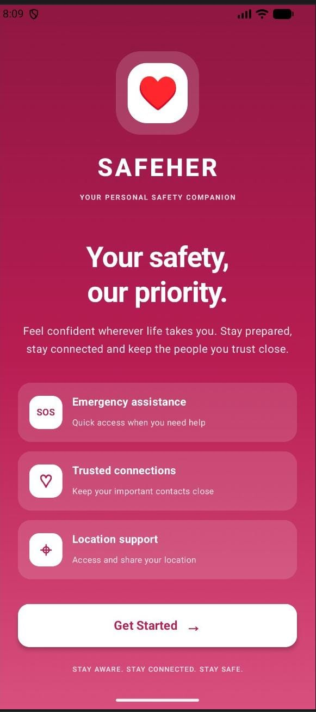
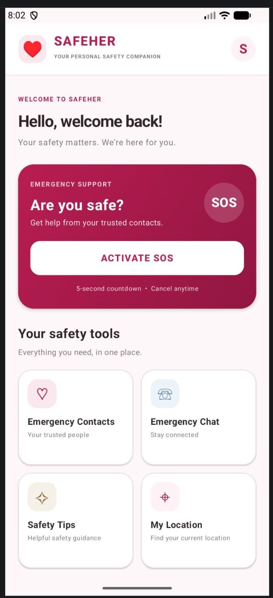
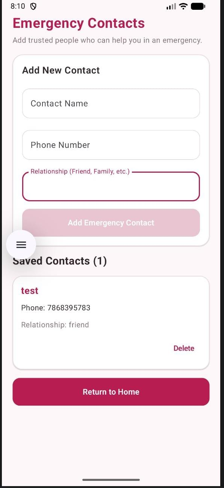
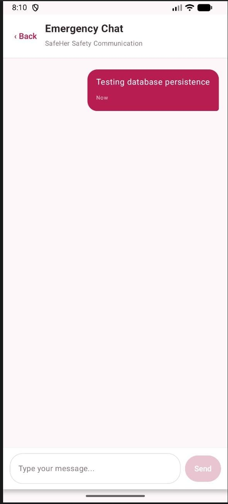
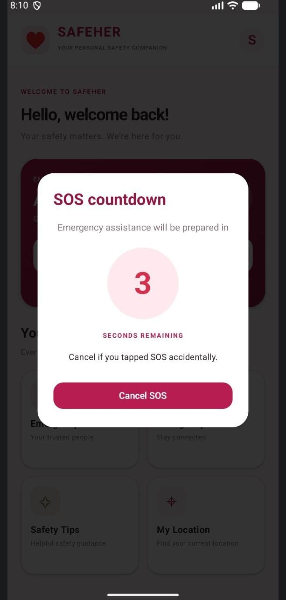
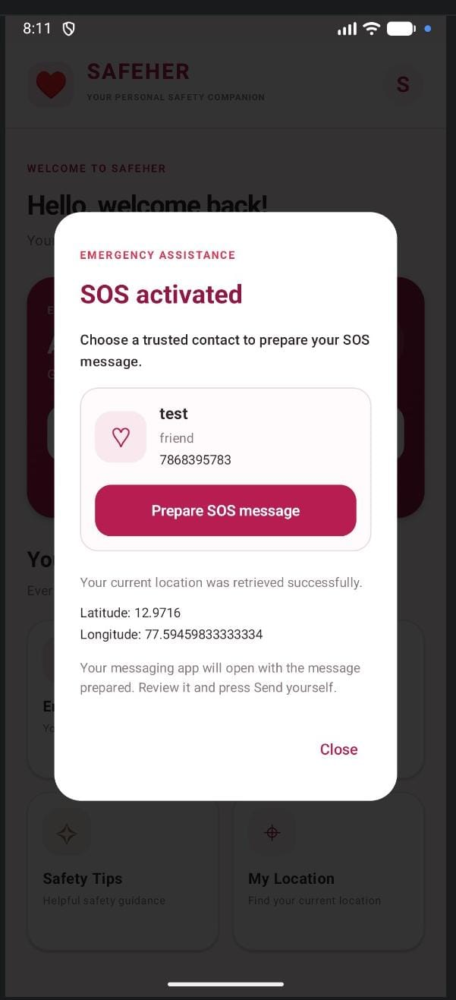
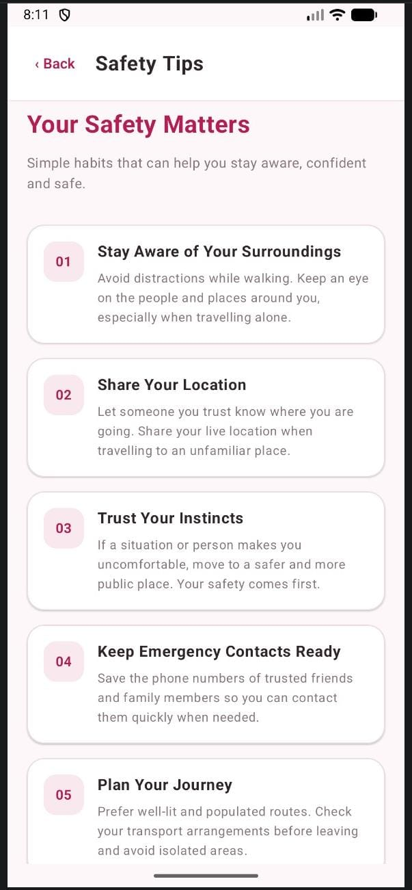
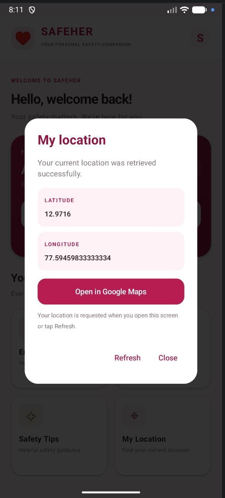

# SafeHer – Personal Safety Application

SafeHer is a **Kotlin Multiplatform personal safety application** developed for Android and iOS. It provides users with essential safety features, including emergency contacts, SOS assistance, location retrieval, and an emergency chat interface.

The application is built using Kotlin and Compose Multiplatform, with shared business logic and platform-specific integrations.

## Features

- **SOS Emergency Assistance:** Initiates an SOS flow with a countdown and cancellation option.
- **Emergency Contacts:** Add, view, and delete emergency contacts.
- **Location Retrieval:** Retrieves and displays the device's current location.
- **SOS Message Preparation:** Prepares an emergency SMS containing location details and opens the messaging application for the user to review and send.
- **Emergency Chat:** Provides a local chat interface with messages stored on the device.
- **Persistent Storage:** Stores emergency contacts and chat messages using SQLDelight.
- **Cross-Platform Support:** Supports Android and iOS with shared application code.

## Screenshots

### Android Application

| Welcome Screen | Home Screen |
|---|---|
|  |  |

| Emergency Contacts | Emergency Chat |
|---|---|
|  |  |

| SOS Countdown | SOS Screen |
|---|---|
|  |  |

| Safety Tips | My Location |
|---|---|
|  |  |

## Technology Stack

| Technology | Purpose |
|---|---|
| Kotlin | Primary programming language |
| Kotlin Multiplatform | Shared application logic |
| Compose Multiplatform | User interface |
| SQLDelight | Local database and persistence |
| Swift / SwiftUI | iOS application integration |
| Android SDK | Android platform integration |
| CoreLocation | iOS location services |
| Git & GitHub | Version control and project hosting |

## Project Architecture

The project follows a layered architecture:

- **UI Layer:** Compose Multiplatform screens.
- **ViewModel Layer:** Manages application state and user interactions.
- **Repository Layer:** Handles data operations.
- **Database Layer:** Uses SQLDelight for local data persistence.
- **Platform Layer:** Implements platform-specific functionality such as location retrieval and SMS preparation.

## Project Structure

```text
SafeHer/
├── androidApp/
│   └── Android application
├── iosApp/
│   └── iOS application
├── shared/
│   └── Shared Kotlin Multiplatform code
│       ├── commonMain/
│       ├── androidMain/
│       └── iosMain/
├── gradle/
├── build.gradle.kts
└── settings.gradle.kts
```

## Running the Application

### Android

1. Clone the repository.
2. Open the project in Android Studio.
3. Allow Gradle to sync.
4. Run the Android application using an emulator or Android device.

To build the Android application:

```bash
./gradlew :androidApp:assembleDebug
```

### iOS

1. Open the `iosApp` directory in Xcode.
2. Select an iOS simulator or connected iPhone.
3. Build and run the application.

## Important Notes

- SOS messages are prepared in the device's messaging application. The user must review and manually send the message.
- Emergency Chat currently uses locally stored messages and does not provide live communication between different users.
- SMS functionality requires a compatible device and messaging service. The iOS simulator does not support sending SMS.

## Future Enhancements

- Live communication between trusted contacts.
- Cloud-based data synchronization.
- Additional emergency assistance integrations.
- Further testing on physical Android and iOS devices.

## Author

**Ambika B**

- GitHub: [Ambikab23](https://github.com/Ambikab23)
- LinkedIn: [Ambika B](https://www.linkedin.com/in/ambikabandappa/)

---

Developed as a Kotlin Multiplatform project for Android and iOS.